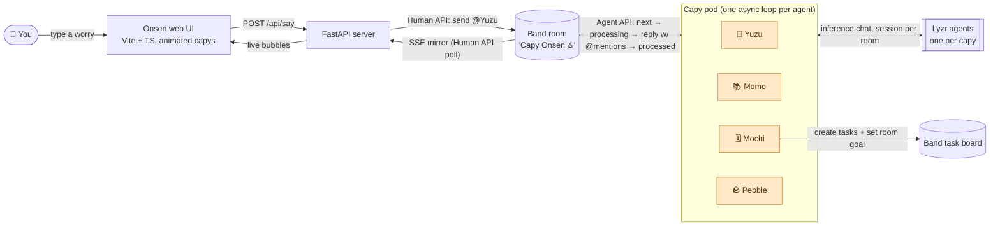

# ♨️ Capy Onsen

**Bring your stress to the hot spring.**

When life piles up (an exam Friday, a move Saturday, mom's birthday Sunday), most of us freeze, because a chatbot just hands back a wall of text that feels like one more thing to deal with. Capy Onsen gives you a pod of four capybara agents instead. You drop your messy worry into the water, and they talk it through *with each other*: one sorts out what really matters, one puts the steps in order, and one checks that the plan is realistic and leaves room for rest. Then the host capy brings you one calm plan to approve. Once you say yes, the plan becomes real tasks on a shared task board, so you leave with a plan and a calmer head, not a lecture.

---

## Sponsors used

| Sponsor | What we use | Where it shows up |
|---|---|---|
| **Band** | Multi-agent rooms, @mention routing, Agent API message loop, Human API, task board and room goal | The capys are four real Band agents that talk to each other and to you in a shared Band room |
| **Lyzr** | Agent Studio agents (Agents API) and the inference chat API with per-room sessions | Each capy's personality and reasoning is its own Lyzr agent |

---

## Meet the pod

| Capy | Role | What it does in the room |
|---|---|---|
| 🍊 **Yuzu** | Host | Welcomes you, @mentions the pod, merges their notes into one plan, and asks for your approval |
| 📚 **Momo** | Researcher | Finds the real deadlines and what can wait |
| 🗓️ **Mochi** | Planner | Puts small steps in order, then writes the approved plan to the Band task board |
| 🪨 **Pebble** | Reality-checker | Points out what's unrealistic, what to delegate, and reminds you to rest |

---

## Architecture



**Conversation flow**

```
You ──@Yuzu──▶ Yuzu (Lyzr: WELCOME) ──@Momo @Mochi @Pebble──▶ three helpers run in parallel
                                                              (each calls its own Lyzr agent)
Momo / Mochi / Pebble ──@Yuzu──▶ Yuzu waits for all 3 notes ──▶ Yuzu (Lyzr: PLAN) ──@You──▶ "does this feel okay?"
You ──"yes!"──▶ Yuzu ──@Mochi──▶ Mochi (Lyzr: CHECKLIST) ──▶ Band room goal + task board items ──@You──▶ ☐☐☐
```

Everything the capys say really happens in Band. The onsen UI is a cute *mirror* of the Band room, so you can open the same room in the Band web app and watch the agents @mention each other live.

---

## Band: how we use it

Band is where the capys live and talk. We use the REST Agent API and Human API directly; the logic is in `backend/capy/band.py` and `backend/capy/pod.py`.

- **Four real Band agents, registered in code.** `setup_capys.py` calls `POST /me/agents/register` once per capy and stores each agent's own API key. It then creates a shared room with `POST /me/chats` and adds all four as participants.
- **@mention routing is the coordination layer.** We wrote no custom message bus between the agents. Yuzu delegates by sending a message that @mentions Momo, Mochi and Pebble, and they answer by @mentioning Yuzu back. Band only delivers a message to the agents it mentions, so each capy wakes up only when someone talks to it.
- **The documented agent message lifecycle.** Each capy runs its own loop: `GET /agent/chats/{id}/messages/next` → `POST …/processing` → think → `POST /agent/chats/{id}/messages` (with `mentions`) → `POST …/processed`. Failures are marked `…/failed`, and message IDs are deduped because delivery is at-least-once.
- **Human in the loop.** You are a participant in the room too. Yuzu @mentions you with the plan and waits. Your reply, sent from our UI through the Human API (`POST /me/chats/{id}/messages`) or typed straight into the Band app, approves the plan or asks for changes. "Less on Saturday please" sends Yuzu back to revise the plan instead of approving it.
- **Task board and room goal.** After approval, Mochi sets the room goal (`PUT /agent/chats/{id}/board`) and creates one task per checklist step (`POST /agent/chats/{id}/tasks`). The plan ends up in Band's task board, where you can track it, not just in a chat bubble.
- **A live mirror.** The server polls the room with `GET /me/chats/{id}/messages?after=<last_id>` and streams it to the UI over SSE, so what you see is exactly what Band has.
- **Fresh rooms for every session.** `POST /api/reset` creates a new Band room with the same pod, so each worry gets its own clean room.

## Lyzr: how we use it

Lyzr is each capy's brain. Every capybara is its own Lyzr agent with its own role, goal and instructions; the client is in `backend/capy/lyzr.py` and the personas are in `backend/capy/config.py`.

- **Agents created from code.** `setup_capys.py` creates four Lyzr agents (`POST /v3/agents/`) with distinct roles: host, researcher, planner and reality-checker. They share a "calm capybara in a hot spring" voice: under 60 words, no lecturing, and no invented facts.
- **One agent, several modes.** Yuzu's instructions define **WELCOME**, **PLAN** and **REVISE** modes, and Mochi has a **CHECKLIST** mode that returns strict `- ` lines we parse into Band tasks. The orchestration code picks the mode; Lyzr does the thinking.
- **Session memory per room.** Every call to `POST /v3/inference/chat/` uses `session_id = <band room id>-<capy>`. Each capy remembers the conversation in that room, and a new room starts fresh.
- **Parallel specialists.** Momo, Mochi and Pebble call their Lyzr agents at the same time, which keeps the whole pod round to a few seconds. Yuzu then merges their three notes into one plan.
- **Swappable models.** The agents run `gpt-4o-mini` through Lyzr's provider layer, so changing the model is a config change in Lyzr Studio, not a code change.

---

## Run it

Requirements: Python 3.11+ with [uv](https://docs.astral.sh/uv/), Node 22+ with pnpm, a Band account, and a Lyzr API key.

```bash
# 1. secrets (gitignored)
cat > .env <<EOF
LYZR_API_KEY=...
BAND_USER_API_KEY=...
EOF

# 2. one-time: create 4 Lyzr agents, 4 Band agents, and the room (writes capys.json, gitignored)
cd backend
uv sync
uv run python setup_capys.py

# 3. build the onsen UI and start everything
cd ../web && pnpm install && pnpm build
cd ../backend && uv run uvicorn server:app --port 8000
```

Open http://localhost:8000, drop a worry in the water, and open the same room at https://app.band.ai to watch the agents work.

## Repo layout

```
backend/
  capy/band.py      Band Human + Agent API client
  capy/lyzr.py      Lyzr agent creation + chat
  capy/config.py    capy personas, settings
  capy/pod.py       the pod: per-agent loops + orchestration
  setup_capys.py    one-time provisioning
  server.py         FastAPI: SSE mirror, /api/say, /api/reset, serves the UI
web/                Vite + TypeScript onsen UI (pnpm)
```
